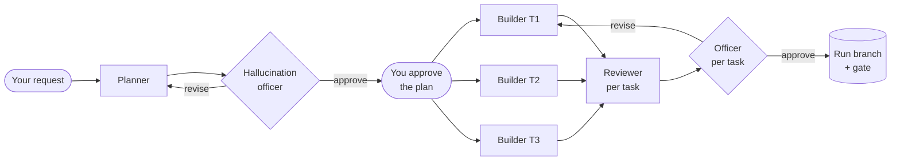

<p align="center">
  
</p>

<p align="center">
  
  
  
  
</p>

<p align="center"><em>One request in. A planned, audited, reviewed branch out.</em></p>

<p align="center"><a href="https://coordinator.kodexa.workers.dev"><strong>coordinator.kodexa.workers.dev</strong></a></p>

---

Coordinator turns a single `/coordinate` request into a small team of Claude Code agents that work in the
background while you do something else. A planner splits the work, a **hallucination officer** checks the plan
against your exact words, you approve it once, and builders work through it **in parallel**. Each builder works
in its own git worktree, and each task is reviewed and checked again before it is merged.

The conductor never plays an instrument. Scheduling, merging, the gate and the live page are plain code and
cost no tokens. The agents spend tokens only on planning, building and checking.

## How a run flows



1. **Plan.** A strong planner reads the code your request touches, not the whole repo, and writes `plan.md` plus
   one brief per task. Each task gets its dependencies, the files it may change, its size, and the model and
   effort it needs.
2. **Audit.** The hallucination officer compares the plan with everything you have said. It looks for invented
   requirements, enterprise-sized answers to simple asks, missed requirements, padded tasks, needlessly serial
   steps and the wrong model for the job. It sends the plan back until it holds up; after three rounds, it asks
   you.
3. **Approve.** You read the plan on the live page or in chat and approve it, or say what to change. This is the
   one stop in the run.
4. **Build in parallel.** Tasks that don't depend on each other and don't share files run at the same time, each
   in its own worktree. Each builder runs its own reviewer and fixes what it finds.
5. **Audit and merge.** The officer checks each finished task against the plan and your words, without reading
   the code. The scheduler then commits, merges into the run branch, runs your gate and pushes. A conflict or a
   failing gate becomes a small fix task of its own. A draft pull request shows your full request, the plan and
   every task, and is updated after each merge, so you can watch the changes land on GitHub.

## Install

**As a Claude Code plugin**

```text
/plugin marketplace add Kodexa-software/Coordinator
/plugin install coordinator@coordinator
```

**From source**, so that `git pull` updates it:

```sh
git clone https://github.com/Kodexa-software/Coordinator.git
cd Coordinator && ./install.sh
```

This links `coord` into `~/.local/bin` and `/coordinate` into `~/.claude/skills`.

**Needs:** a recent Claude Code CLI (`claude`), Python 3.9+, and git. The live pull request uses the GitHub CLI
(`gh`). Before/after screenshots also need Node.js; Playwright is fetched on first use.

## Use

In Claude Code:

```text
/coordinate Add CSV export to the orders table, with the same columns the table shows.
```

The live page opens, the planner gets to work, and Coordinator tells you when the plan is ready. After that, a
few words are enough:

| You say | What happens |
|---|---|
| `/coordinate <request>` | Start a run |
| `/coordinate plan <goal>` | Plan only: goals, milestones and tasks, saved in the project for a later run |
| `/coordinate status` | Open the live page; one line in chat |
| `/coordinate approve` | Approve the plan; building starts |
| `/coordinate answer T3 <text>` | Answer an agent's question |
| `/coordinate tell T3 <text>` | Send a note to a running agent; it arrives at its next step |
| `/coordinate add <text>` | Change the plan or add work; it goes back through the officer and you |
| `/coordinate pause` / `resume` | Agents write an exact next step and stop / pick up where they stopped |
| `/coordinate run` | Build a plan-only run, today or weeks later |
| `/coordinate shots [note]` | Before/after screenshots (base branch vs run branch) as one PNG on your Desktop |
| `/coordinate map [areas]` | Build or refresh the project map in `.coordinator/map/`, which planners read before the code |
| `/coordinate accept T3` / `retry T3` / `stop T3` | Settle a task the officer keeps sending back / start it fresh / skip it |
| `/coordinate terminate` | End the run: stop every process, remove worktrees and internal files, keep the branch and the knowledge |

With the from-source install, every command also works in a terminal as `coord <command>`, with no model involved.

## The live page

<p align="center"></p>

A small local page shows the tasks moving from queued to working, through the officer's check, to done. It also
has the plan, the officer's reports, and each task's brief, changes and review. You approve plans and answer
questions there too. It runs on `127.0.0.1` only, reads the run's files, and costs nothing to keep open.

## Where things live

| What | Where | After `terminate` |
|---|---|---|
| Project settings | `<project>/.coordinator/config.json` | kept |
| The run's knowledge: `plan.md`, `tasks.json`, and per task `knowledge.md`, `changes.md`, `review.md`, officer reports | `<project>/.coordinator/<run>/` | kept, so a later run can continue |
| Processes, logs, worktrees | `~/.coordinator/runs/<run>/` | removed |
| Run branch | `coord/<run>`, pushed after every merged task, with a draft PR | kept |
| Task branches | `coord-tasks/<run>/<task>` | removed |

`.coordinator/` is added to the project's `.gitignore` (and its local `.git/info/exclude`), so it is never committed by
accident. Set `"gitignore": false` to keep your `.gitignore` untouched.

## Configuration

`<project>/.coordinator/config.json`. The planner fills in `gate`, `setup` and `dev` on the first run if you
haven't.

| Key | Default | Meaning |
|---|---|---|
| `gate` | `""` | Commands that prove a change (typecheck, lint, tests, build). Run by builders, and again after each merge |
| `gate_cwd` | `"."` | Where the gate runs, relative to the repository root |
| `setup` | `""` | What a fresh worktree needs first, for example linking dependencies from `$COORD_MAIN` |
| `dev` | `{"command": "", "cwd": ".", "ready_path": "/"}` | Dev server for screenshots; `{port}` is replaced with a free port |
| `max_parallel` | `3` | Builders at once |
| `models` / `efforts` | Opus, high | Per role: `planner`, `builder`, `reviewer`, `officer`, `shooter`. The planner can set them per task |
| `officer` | `{"plan": true, "tasks": true, "max_rounds": 3}` | Where the officer checks, and how many rounds before it asks you |
| `permission_mode` | `"auto"` | Permission mode for background agents |
| `deny` | push, commit, rebase, `reset --hard`, `gh pr`, publish, `sudo`, ... | Commands agents may never run |
| `test_names` / `test_dirs` | common test file and folder patterns | What counts as a test file for the tests guard |
| `gitignore` | `true` | Add `.coordinator/` to the project's `.gitignore` when it isn't there |
| `push` / `pr` | `true` | Push the run branch after every merged task, and keep a draft PR with the request, the plan and the tasks up to date |
| `base_branch` | the current branch | What the run branch starts from |

## Design languages and the project map

- **Design language, your choice.** When a request involves UI, the planner asks which design language to follow:
  your project's own, Impeccable's (bundled), or another you name. The answer goes to every UI task, its
  reviewer checks against it, and the officer checks the plan sticks to one.
- **A map of your project.** `/coordinate map` builds a small, cited map of the code in `.coordinator/map/`, using
  the System map method of Interpretable Context Methodology. Planners read it first instead of exploring the
  repository on every run, and the officer checks it before it counts.

Both are built in, with no other skills needed: Coordinator bundles the parts it uses, with credit and their
licences, in [third_party/](third_party/README.md).

## Guard rails

- **Your words are the spec.** The request, every later addition and every answer are kept word for word. The
  planner and the officer judge against all of them.
- **No tests unless you ask.** A task's tests are off by default, and a hook blocks builders from touching test
  files while they are. When you do ask, the reviewer and the officer check the tests are few, short and
  relevant.
- **Agents stay in their lane.** A builder writes only inside its worktree and its task folder. The planner
  writes only the run's files. Agents never commit, push or switch branches; the scheduler commits.
- **Live on GitHub, never on your base branch.** After every merged task the run branch is pushed and its draft
  pull request is updated. Nothing is merged into your base branch for you. Set `"push": false` to keep a run
  local.

## How it compares

|  | **Coordinator 0.2** | Coordinator 0.1 (earlier, unpublished) | The `/loop` skill |
|---|---|---|---|
| What runs the show | A script, at no token cost. Agents are separate background sessions | An Opus coordinator session, with lead agents under it | One session re-running a prompt on a schedule |
| Who writes the code | Opus by default; the planner picks per task and the officer checks the pick | Mostly Sonnet workers; Opus only managed | The session's own model |
| Steps between your words and the code | One: a brief, checked by the officer | Three: coordinator, then lead, then worker | None |
| Parallel work | Yes: a worktree per task, with a file-overlap check | No: one task at a time | No |
| Guard against invented scope | The officer audits the plan and every task, until it is right | Reviewers compared diffs with briefs | None built in |
| Your approval | Once, on an audited plan | Ad hoc | None built in |
| Tests | Off unless you ask; enforced by a hook | Written by default | Whatever the prompt says |
| Proof work | The gate per task and one review; screenshots on request | Before/after pairs, pixel diffs, perf traces and full gates at every step | None built in |
| Status | A live local page, notifications, and a draft PR updated after every task | Status files and HTML reports written by agents | The chat |
| Context per agent | Small: a fresh session per task | Grew to 250-460K tokens per worker | Grows with every iteration |
| Pause, resume, plan-only, terminate | Yes, including resume weeks later from the project's files | Pause and resume through notes | Stop only |
| Best for | Requests that split into several tasks | Retired | Watching something over time; short sequential lists |

### What 0.1 cost, measured

Two real component-upgrade runs on the earlier version, from their transcripts:

|  | Run A | Run B | Similar work in one direct session |
|---|---|---|---|
| Tokens | 212M | 371M, and not finished | 87M (a smaller component) |
| Agents | 40 | 64 | 0 |
| Wall-clock | ~12 h | 23 h+ | ~4 h |

Across the two runs, there were about 1,200 screenshot and pixel-diff commands and 266 full gate runs. One run
needed a whole cleanup task, which cut its pull request from 10,406 changed lines to 3,328. Those numbers shaped
0.2: fewer and stronger agents, parallel work, an officer in place of after-the-fact cleanup, and no proof work
nobody asked for. Numbers for 0.2 will be added here once it has done real runs of the same size.

## Roadmap

- Measured comparisons on real runs
- A website and fuller documentation
- A dependency-graph view and a timeline on the live page
- Desktop notifications beyond macOS
- Starter configs for common stacks

## Credits

Coordinator bundles material from [Impeccable](https://github.com/pbakaus/impeccable) by Paul Bakaus (Apache 2.0)
and [icm-architect](https://github.com/RinDig/icm-architect) by Jake Van Clief (MIT). See
[third_party/README.md](third_party/README.md) for what was taken and how it is used.

## Support

Coordinator is built and maintained by [Kodexa](https://github.com/Kodexa-software) and will keep evolving. Issues and
ideas are welcome on [GitHub](https://github.com/Kodexa-software/Coordinator/issues). Changes are listed in
[CHANGELOG.md](CHANGELOG.md).

## License

[MIT](LICENSE)
