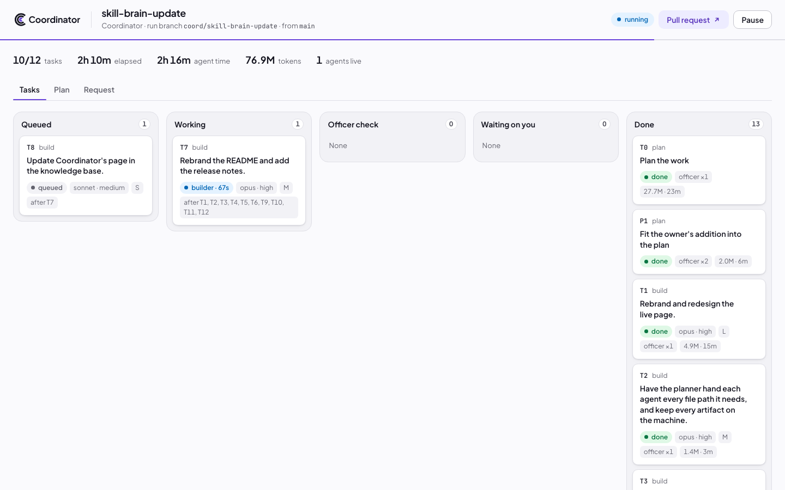

<p align="center">
  
</p>

<p align="center"><em>One request in. A planned, audited, reviewed branch out.</em></p>

<p align="center"><a href="https://coordinator.kodexa.workers.dev"><strong>coordinator.kodexa.workers.dev</strong></a></p>

<p align="center">
  
  
  
  
</p>

---

Coordinator turns one `/coordinate` request into a small team of Claude Code agents working in the background. A
planner splits the work, a **hallucination officer** checks the plan against your exact words, you approve it once,
and builders work **in parallel**, each in its own git worktree, reviewed and checked again before it is merged.

The conductor never plays an instrument: scheduling, merging, the gate and the live page are plain code and cost no
tokens. This repo is the skill; the [website](https://coordinator.kodexa.workers.dev/docs/) has the docs.

## Install

```sh
git clone https://github.com/Kodexa-software/Coordinator.git ~/.coordinator/app && ~/.coordinator/app/install.sh
```

On Windows, in PowerShell:

```powershell
git clone https://github.com/Kodexa-software/Coordinator.git "$HOME\.coordinator\app"
powershell -ExecutionPolicy Bypass -File "$HOME\.coordinator\app\install.ps1"
```

Then start a new Claude Code session and type `/coordinate`. Needs a recent Claude Code CLI, Python 3.9+ and git;
`gh` for the pull request, Node.js for screenshots. As a plugin, or more detail:
[Install](https://coordinator.kodexa.workers.dev/docs/install/).

## Update

```text
/coordinate update
```

Or `coord update` in a terminal, then start a new session. Plugin install:
[Update](https://coordinator.kodexa.workers.dev/docs/update/).

## Remove

```sh
rm ~/.local/bin/coord ~/.claude/skills/coordinate
rm -rf ~/.coordinator
```

End any active run first with `/coordinate terminate`. Plugin install:
[Uninstall](https://coordinator.kodexa.workers.dev/docs/uninstall/).

## How a run flows


- **Plan.** The planner reads only the code your request touches and gives each task every file path it needs.
- **Audit.** The officer sends the plan back until it matches your words: nothing invented, nothing missed.
- **Approve.** Your one stop. Asks that belong to another repo start follow-up runs there, so none is dropped.
- **Build.** Independent tasks run at once, each with its own reviewer. The draft pull request opens as work
  starts and tracks every task.
- **Merge.** The officer checks each task, then the scheduler commits, merges, runs your gate and pushes. Nothing
  reaches your base branch for you.
- **Describe.** Once every task has merged, a writer describes the change in the pull request the way a senior
  engineer would: one short paragraph, one to three lines, on what and why.

Every agent works like a senior engineer, and its code carries no comments beyond the rare one a senior would
write. Nothing leaves your machine: screenshots and other artifacts stay in the task's folder.
[How it works](https://coordinator.kodexa.workers.dev/docs/how-it-works/) ·
[Philosophy](https://coordinator.kodexa.workers.dev/docs/philosophy/).

## The live page

<p align="center"></p>

A local page on `127.0.0.1` shows the tasks moving from queued to done. Read each agent's conversation live, open
any file or image, approve the plan with an answer per question, and see everything waiting on you in one list.
The Files tab lists every file in the run's folder and each task's folder, with image previews; anything the viewer
can't show opens in a new tab or in Finder.
The Full auto switch in its top bar hands every decision to `/coordinate` while you're away.

## Full auto

Off by default. Begin a request with `<full auto>`, or flip the switch on the live page, and you count as away.
The `/coordinate` session takes your place:

- it approves the plan, using the default answers unless your words say otherwise;
- it answers the agents' questions;
- it settles officer stalemates and retries stalled tasks;
- when the run is done, it merges every pull request and ends every run.

The agents work exactly as in any other run. Anything it can't settle waits for you, and then nothing is merged.
Keep the `/coordinate` session open: it is the one deciding.

## Commands

| You say | What happens |
|---|---|
| `/coordinate <request>` | Start a run |
| `/coordinate <full auto> <request>` | Start a run while you're away: `/coordinate` decides for you, merges and ends it |
| `/coordinate auto on` / `auto off` | Switch full auto on or off for the current run |
| `/coordinate plan <goal>` | Plan only, saved in the project for a later run |
| `/coordinate status` | Open the live page; what's waiting on you in chat |
| `/coordinate approve` | Approve the plan (or on the live page, per question); building starts |
| `/coordinate answer T3 <text>` | Answer an agent's question |
| `/coordinate tell T3 <text>` | Send a note to a running agent |
| `/coordinate add <text>` | Change the plan or add work; it goes back through the officer and you |
| `/coordinate pause` / `resume` | Agents write an exact next step and stop / pick up where they stopped |
| `/coordinate run` | Build a plan-only run, today or weeks later |
| `/coordinate shots [note]` | Before/after screenshots as one PNG, saved in the shots task's folder |
| `/coordinate todo` / `todo done <n>` | Manual steps only you can do / mark one done |
| `/coordinate accept T3` / `retry T3` / `stop T3` | Settle a task / start it fresh / skip it |
| `/coordinate update` | Update Coordinator |
| `/coordinate merge` | Merge every pull request of the run and its follow-up runs, then end them all |
| `/coordinate terminate` | End the run; keep the pull request's branch and delete the run's task files |
| `coord map [areas]` | Build or refresh the project map that planners read first |

With the clone install, every command also works in a terminal as `coord <command>`, with no model involved.
[All commands](https://coordinator.kodexa.workers.dev/docs/commands/).

## Docs

- [Configuration](https://coordinator.kodexa.workers.dev/docs/configuration/): settings, and where every file lives.
- [How it works](https://coordinator.kodexa.workers.dev/docs/how-it-works/): roles, the live page, design languages,
  the project map.
- [Philosophy](https://coordinator.kodexa.workers.dev/docs/philosophy/): guard rails, tests off unless you ask,
  your project's rules first.

The earlier 0.1, measured on two real runs, spent 212M and 371M+ tokens across 40 and 64 agents. 0.2 was rebuilt
for fewer, stronger agents in parallel, with an officer instead of cleanup. Next: measured numbers for today's
version, and more on the live page.

**Maintainers:** every commit to `main` triggers the website's deploy through `.github/workflows/website.yml`,
which needs the `WEBSITE_DEPLOY_TOKEN` secret.

## Credits

Coordinator bundles material from [Impeccable](https://github.com/pbakaus/impeccable) by Paul Bakaus (Apache 2.0)
and [icm-architect](https://github.com/RinDig/icm-architect) by Jake Van Clief (MIT). See
[third_party/README.md](third_party/README.md) for what was taken and how it is used.

## Support

Coordinator is built and maintained by [Kodexa](https://github.com/Kodexa-software). Issues and ideas are welcome on
[GitHub](https://github.com/Kodexa-software/Coordinator/issues). Changes are in [CHANGELOG.md](CHANGELOG.md).

## License

[MIT](LICENSE)
